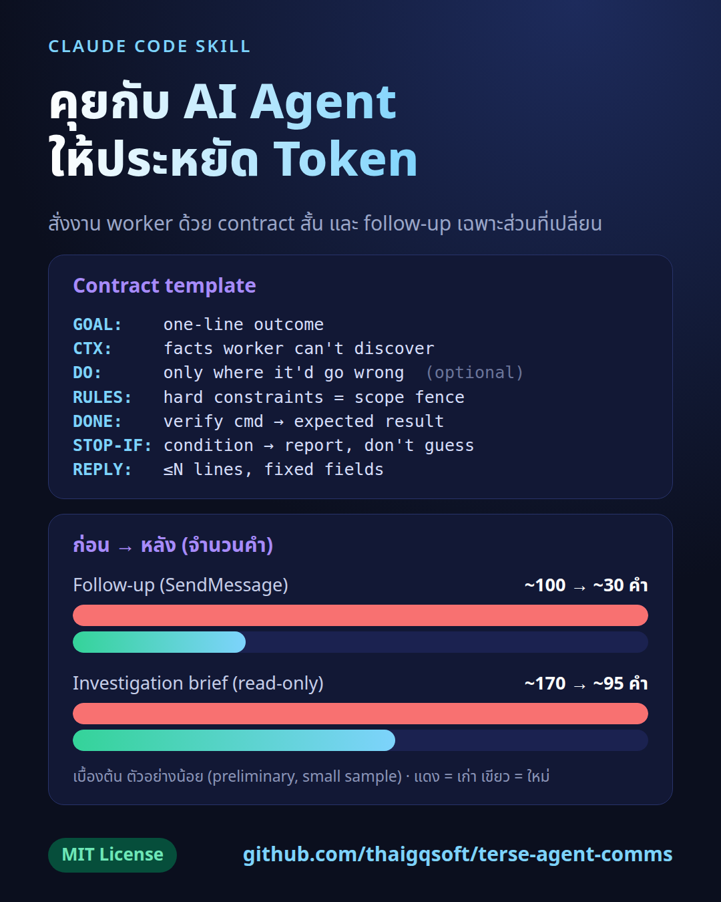

# terse-agent-comms



Claude Code skill: ทำให้ข้อความจาก orchestrator ถึง worker agent ประหยัด token / make orchestrator-to-worker agent messages token-cheap.

## ภาษาไทย

### คืออะไร / ทำไมต้องใช้
เวลา agent หลักสั่งงาน agent ลูก (subagent, CLI wrapper, SendMessage) ข้อความมักยาวเกินจำเป็น: มีคำนำ ประวัติ และสิ่งที่ worker รู้อยู่แล้วซ้ำไปซ้ำมา สกิลนี้กำหนดรูปแบบสั้น ๆ 2 แบบ:

- **Worker ใหม่** ได้ "contract" สั้น: `GOAL / CTX / DO / RULES / DONE / STOP-IF / REPLY`
- **Worker ที่คุยอยู่แล้ว** ได้เฉพาะ "delta" คือสิ่งที่เปลี่ยน ไม่ต้องเล่าซ้ำ

มีงบจำนวนคำต่อประเภทข้อความ (delta ≤30, แก้ไฟล์ ≤60, ค้นหา ≤80, สืบสวน/รีวิว ≤120) และรูปแบบรายงานกลับที่เป็น field ตายตัว

### ตัวอย่าง ก่อน → หลัง (follow-up)
ก่อน (~100 คำ): ทักทาย ทวนบริบท ทวนกฎทั้งหมดอีกรอบ แล้วค่อยบอกว่า lock ค้าง

หลัง (~30 คำ):
```
Lock is stale (no git proc). rm .git/index.lock, then add + commit as briefed. Same REPLY.
```

### ผลทดสอบเบื้องต้น (preliminary, small sample, ใช้ haiku เป็นผู้เขียน)
| ประเภท | สกิลเก่า | สกิลใหม่ |
|---|---|---|
| follow-up (SendMessage) | ~100 คำ | ~30 คำ |
| brief สืบสวนแบบ read-only | ~170 คำ | ~95 คำ (คง fence ไว้) |

ตัวอย่างน้อย ยังไม่ใช่ benchmark ที่เข้มงวด

### ติดตั้ง
```bash
git clone https://github.com/thaigqsoft/terse-agent-comms.git
cp -r terse-agent-comms/terse-agent-comms ~/.claude/skills/
```
หรือดาวน์โหลด release zip แล้วแตกโฟลเดอร์ `terse-agent-comms` ไปไว้ที่ `~/.claude/skills/`

ติดตั้งบรรทัดเดียว (เฉพาะ SKILL.md):
```bash
mkdir -p ~/.claude/skills/terse-agent-comms && curl -fsSL https://raw.githubusercontent.com/thaigqsoft/terse-agent-comms/main/terse-agent-comms/SKILL.md -o ~/.claude/skills/terse-agent-comms/SKILL.md
```

---

## English

### What / why
When a main agent dispatches work to workers (subagents, CLI wrappers, SendMessage), the prompts tend to bloat: role preambles, background, and facts the worker already holds, repeated every turn. This skill sets two short forms:

- **Fresh worker** gets a short contract: `GOAL / CTX / DO / RULES / DONE / STOP-IF / REPLY`
- **Worker that already has the contract** gets only a delta: the new fact or correction, plus the next action

It also defines word budgets per message type (delta ≤30, mechanical edit ≤60, search ≤80, investigation/review ≤120) and a fixed-field worker reply format.

### Before -> after (follow-up)
Before (~100 words): greeting, re-stated context, all rules repeated, then "the lock is stale".

After (~30 words):
```
Lock is stale (no git proc). rm .git/index.lock, then add + commit as briefed. Same REPLY.
```

### Test results (preliminary, small sample, haiku as writer)
| Message type | Old skill | New skill |
|---|---|---|
| Follow-up (SendMessage) | ~100 words | ~30 words |
| Read-only investigation brief | ~170 words | ~95 words (fence kept) |

Small sample; not a rigorous benchmark.

### Install
```bash
git clone https://github.com/thaigqsoft/terse-agent-comms.git
cp -r terse-agent-comms/terse-agent-comms ~/.claude/skills/
```
Or download the release zip and put the `terse-agent-comms` folder in `~/.claude/skills/`.

One-liner (SKILL.md only):
```bash
mkdir -p ~/.claude/skills/terse-agent-comms && curl -fsSL https://raw.githubusercontent.com/thaigqsoft/terse-agent-comms/main/terse-agent-comms/SKILL.md -o ~/.claude/skills/terse-agent-comms/SKILL.md
```

## License
MIT (c) 2026 thaigqsoft
